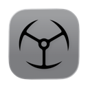

<p align="center">
  
</p>

<h1 align="center">Imperator MenuBarFolders</h1>

<p align="center">
  Group your apps into folders that live in the macOS menu bar. Each folder is its
  own menu bar icon; click it and a panel drops down with the apps inside.
</p>

## Requirements

Requires macOS 14 or later, Apple silicon. Built and tested on macOS 27 only. Older versions are
expected to work but have not been verified.

Install at your own risk. The app is not notarized and carries no Apple Developer signature, so
macOS cannot vouch for it. It is provided as is, with no warranty, under the
[MIT license](LICENSE).

## Install

Download the latest zip from
[Releases](https://github.com/goranimperator/imperator-menubarfolders/releases), unzip, and move
`Imperator MenuBarFolders.app` to `/Applications`.

The app is signed with a self-signed certificate and is not notarized, so Gatekeeper blocks the
first launch. Right-click the app and choose **Open**, or clear the quarantine flag:

```bash
xattr -dr com.apple.quarantine "/Applications/Imperator MenuBarFolders.app"
```

There is no Dock icon. The app lives in the menu bar. On first launch it has no folders yet, so the
settings window opens on its own.

## Permissions

None. The app requests no Accessibility, Input Monitoring, or Automation grants, and declares no
`NSUsage` keys. It reads `/Applications`, `/System/Applications`, `~/Applications` and
`/Applications/Xcode.app/Contents/Applications` to list what is installed, reads mounted external
drives when **Scan drives for apps** is on, and launches apps through `NSWorkspace`. **Choose App…**
in the app picker opens the standard `NSOpenPanel`, so an app anywhere else on disk is reached by
the file dialog rather than by a wider scan.

The one system integration is **Open at Login**, the toggle in the panel footer and in the
settings window sidebar. It calls `SMAppService.mainApp.register()`, which adds the app to Login
Items in System Settings. Turning the toggle off unregisters it.

## Use

Each folder you create becomes its own icon in the menu bar. Click an icon and a panel drops down
with that folder's apps; click an app to launch it. Clicking the same icon again closes the panel,
as does Escape or a click in another app. The panel footer holds the **Open at Login** toggle on
the left, and **Settings**, **About** and **Quit** on the right.

The settings window is where folders are built:

| Control | What it does |
|---------|--------------|
| Sidebar `+` | Create a folder |
| Folder icon | Open the icon picker: 138 Lucide icons, searchable, or paste your own SVG |
| Name field | Rename the folder; the name is also the menu bar icon's tooltip |
| Per row | 2 to 6 apps per row in the panel |
| Per page | How many apps one page holds before the grid pages sideways |
| Arrange | Wiggle the icons so they can be moved and removed; holding an app does the same |
| Add Apps | Pick from everything installed; apps marked **Menu bar app** declare `LSUIElement` |
| Choose App… | Pick an app anywhere on disk, for anything the scan does not reach |
| Scan drives for apps | Look for apps on mounted external drives, with one switch per drive under it |
| Double-click an app | Give it a custom label |
| Eye | Hide a folder from the menu bar, or bring it back |
| Drag | Reorder folders in the sidebar, or apps in the grid: the row or icon lifts and the rest slide out of its way |

The panel sizes itself from one page rather than from the whole folder, so a folder of forty apps
opens the same height as a folder of nine and pages sideways for the rest. A folder with fewer apps
than a page holds is only as tall as it needs. If the page shape asks for more height than the
display has below the menu bar, the panel holds fewer apps per page and makes more pages, rather
than growing past the screen and cutting off its own footer.

**Scan drives for apps** sits under Add Folder in the sidebar and is on by default. The four
standard app directories are walked in full; a mounted external drive is walked three levels deep,
which reaches an app on the disk itself, in a folder on it, and one below that. The cap is there
because a drive is a whole filesystem, and a Time Machine store is skipped outright. Each mounted
drive gets its own switch under the master one, keyed by the name Finder shows, so turning a drive
off survives unplugging it. Anything deeper than the cap, on a network share, or on a drive you
switched off is reached with **Choose App…** in the app picker.

A hidden folder keeps its apps and its row in the settings window; it just owns no menu bar icon.
The eye at the right of the row toggles it.

Deleting the last folder reopens the settings window, and so does hiding the last visible one:
either way no menu bar icons are left, and with no Dock icon there would be no way back in.

Folders are stored as one JSON file:

```
~/Library/Application Support/MenuBarFolders/folders.json
```

## Build from source

```bash
make install
```

Builds release, bundles, codesigns, installs to `/Applications`, and launches. Other targets:

```bash
make run
```

```bash
make clean
```

The build passes `-platform_version macos 14.0 <installed SDK>` to the linker. AppKit decides which
generation of a control to draw from the `sdk` field in the binary's `LC_BUILD_VERSION`, and SwiftPM
stamps that field from `platforms:` rather than from the SDK it compiled against, so without the flag
the app reports `sdk 14.0` and draws macOS 14 era switches on macOS 27. Raising `platforms:` would
fix the stamp but make the deployment target the minimum, so the flag sets the two independently:
`minos 14.0`, `sdk` whatever is installed.

Signing uses the self-signed `Imperator Dev` identity by default. It has to be a stable identity
rather than ad-hoc: the login item registration is keyed to the bundle's designated requirement, and
ad-hoc signing mints a new hash on every build, so each update would look like a different app and
drop the registration. Override it if you do not care:

```bash
make build CODESIGN_IDENTITY=-
```

## Release

Build a zip without touching git or the remote:

```bash
make dist VERSION=x.y.z
```

Cut a full release, which bumps `Info.plist`, commits, tags `vx.y.z`, pushes, and publishes a GitHub
release with the zip attached:

```bash
make release VERSION=x.y.z
```

Requires the [GitHub CLI](https://cli.github.com) (`brew install gh`, then `gh auth login`). The
working tree must be clean. Tags are plain semver (`v1.0.0`); the release title carries the app
name. `CFBundleVersion` is set from `git rev-list --count HEAD` and is never edited by hand.

## Layout

| Path | Role |
|------|------|
| `Sources/MenuBarFolders/main.swift` | Entry point, `.accessory` activation policy, forced dark mode |
| `Sources/MenuBarFolders/AppDelegate.swift` | Lifecycle, settings window, app menu with Cmd+Q |
| `Sources/MenuBarFolders/AppColors.swift` | Brand colour |
| `Sources/MenuBarFolders/Models/` | `MenuBarFolder`, `AppEntry`, both `Codable` |
| `Sources/MenuBarFolders/Services/FolderStore.swift` | `@Observable` store, JSON persistence |
| `Sources/MenuBarFolders/Services/MenuBarManager.swift` | One `NSStatusItem` per folder, panel lifecycle |
| `Sources/MenuBarFolders/Services/MenuBarPanel.swift` | The menu bar panel itself: corner, material, dismissal |
| `Sources/MenuBarFolders/Services/AppDiscovery.swift` | Scans the app directories and external drives, reads `LSUIElement` |
| `Sources/MenuBarFolders/Services/GridPaging.swift` | Page arithmetic and the scroll plumbing, with no views in it |
| `Sources/MenuBarFolders/Services/LucideIcons.swift` | 138 icons as SVG element data, cached as `NSImage` |
| `Sources/MenuBarFolders/Services/SVGRenderer.swift` | SVG elements and path data to `NSBezierPath` |
| `Sources/MenuBarFolders/Views/AboutPanel.swift` | Brand book §10 About panel, `NSPanel` 300x260pt |
| `Sources/MenuBarFolders/Views/AppGridCarousel.swift` | The paged app grid: arranging, swiping, remove badges |
| `Sources/MenuBarFolders/Views/DragGrip.swift` | The two-column dot grip on reorderable rows |
| `Sources/MenuBarFolders/Views/ExternalDrivesView.swift` | The drive scan switches, under Add Folder |
| `Sources/MenuBarFolders/Views/` | SwiftUI: settings window, pickers, panel content |
| `Resources/` | `Info.plist` and app icon |

The menu bar panel is drawn by `MenuBarPanel`, an `NSPanel`, rather than by `NSPopover`. macOS 27
draws its own menu bar panels as plain rounded rectangles with no arrow and no open or close
animation, and `NSPopover` draws neither that shape nor that corner and exposes no radius to set.
The measurements behind the corner, and why the constant is set higher than the corner it draws,
are in `MenuBarPanel.swift`.

The sidebar places its rows by hand in a `ScrollView` and reorders with a plain `DragGesture`
rather than with `List` and `.onMove`. On macOS a List reorders through a system drag session: a
translucent copy of the row follows the pointer and an insertion line marks the target, while the
rows themselves stay put until the drop. Here the row lifts and the others slide into place around
it, and the new order is written once, on release. SwiftUI's own `reorderable()` does this natively
but needs macOS 27, which would drop everyone from 14 to 26.

The app grid works the same way, arranged as an iPhone home screen is. Holding an app, or pressing
Arrange, starts arranging: the icons wiggle, remove badges appear, the held icon lifts out from
under the pointer and the others slide out of its way, and holding it at a side edge turns the page.
The grid and the menu bar panel page sideways three ways: a two-finger swipe on a trackpad, a
mouse wheel, or clicking and dragging the grid to the side. The sidebar does not page; it scrolls.
A trackpad reports a whole gesture, so a page turn is a horizontal swipe and vertical scrolling is
left alone; a plain wheel reports none of that and gets its own rule, two detents on whichever axis
it has. The settings window reads those
scrolls through a local monitor; the menu bar panel cannot, because it never makes the app
frontmost, so it overrides `scrollWheel(with:)` on the window instead.

Swift 6 language mode with `defaultIsolation(MainActor.self)`: everything is on the main actor
unless it is marked `nonisolated`, and the compiler rejects data races instead of warning. The app
scan is the one thing that runs off the main actor, because the picker runs it in a detached task
while its progress view is up. `FolderStore` is `@Observable`, so a view is redrawn by the
properties it actually read rather than by every change to the store.

A SwiftPM executable with no dependencies. `LSUIElement` is true, so there is no Dock icon; the
status items are the entire interface. `MenuBarManager` keys each status item's click back to its
folder UUID with `objc_setAssociatedObject`, because `NSStatusBarButton` carries no user data of its
own.

Because SwiftPM does not compile asset catalogs, menu bar icons cannot ship as image assets. They
are stored as SVG element strings, parsed at runtime, and rendered into template `NSImage`s so macOS
tints them for light and dark menu bars.

`AppDiscovery` lists apps with the string-based `contentsOfDirectory(atPath:)` and then resolves
symlinks, because on macOS Sequoia and later some system apps are Cryptex symlinks that the
URL-based API skips. Its walk carries a depth budget rather than a flat listing: `nil` for the four
standard directories, which are small and known, and 3 for a mounted drive, which is a whole
filesystem. The guard that stops the descent sits after the `.app` check, so a bundle sitting
exactly at the limit is still collected.

## Third-party

Icon path data is derived from [Lucide](https://lucide.dev), used under the ISC license. Portions of
Lucide are held by Cole Bemis 2013-2022 as part of Feather (MIT); all other copyright is held by
Lucide Contributors 2022.

## License

[MIT](LICENSE) &copy; Goran Imperator
